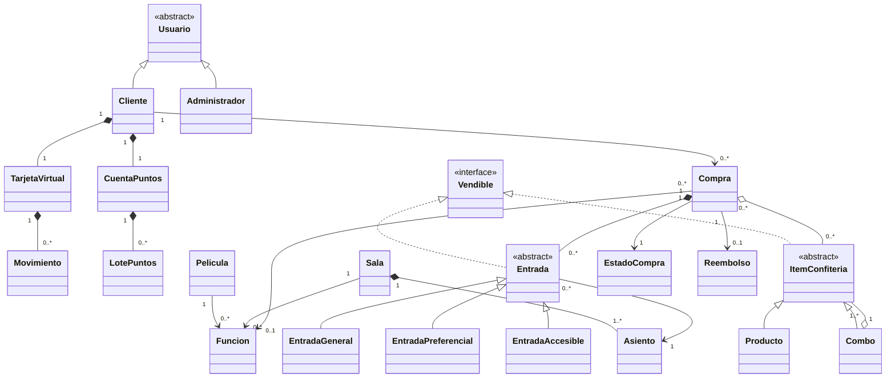

# CinemaUQ – Fase 1: Análisis y diseño

Proyecto Final de Programación II – Universidad del Quindío
Integrantes: **Jorge Esteban Sánchez** (GitHub: Estebansanchez828) y **Julián David Amaya** (GitHub: julianamaya1928)
Repositorio: https://github.com/Estebansanchez828/CinemaUQ
Fuente de verdad: `Proyecto Final PGII A- 20262.docx`. Este análisis se hizo antes de implementar, como lo exige el enunciado (sección 9).

---

## 1. El sistema en un párrafo

CinemaUQ es una aplicación de escritorio (Java 17 + JavaFX, MVC, sin base de datos) para gestionar un cine. El **cliente** consulta la cartelera, elige función y asientos en una cuadrícula, agrega confitería, paga con su **tarjeta virtual**, acumula y redime **puntos CinemaUQ** y cancela compras según el tiempo que falte. El **administrador** gestiona el catálogo, cancela funciones, recarga tarjetas, ve estadísticas y genera reportes (TXT y gráficas).

## 2. Actores

| Actor | Qué hace |
|---|---|
| **Cliente** | Se registra, inicia sesión, compra, paga, consulta tarjeta y puntos, redime, solicita recargas y cancela compras. |
| **Administrador** | Gestiona películas, salas, asientos, funciones, productos, combos y promociones; consulta clientes y compras; cancela funciones; recarga tarjetas; ve estadísticas y genera reportes. |

No hay actores externos (no hay pasarela de pagos ni base de datos).

## 3. Requisitos funcionales

### Cliente
| Código | Requisito |
|---|---|
| RF-001 | Registrarse con nombre, usuario y contraseña. Al registrarse se le crea su tarjeta virtual y su cuenta de puntos. |
| RF-002 | Iniciar y cerrar sesión. |
| RF-003 | Consultar las películas en cartelera y sus funciones (sala, fecha, hora y precio). |
| RF-004 | Seleccionar asientos en una cuadrícula gráfica con colores: disponible, seleccionado, ocupado y accesible. |
| RF-005 | Agregar productos y combos de confitería a la compra. |
| RF-006 | Ver el resumen de la compra con las promociones aplicadas y el total. |
| RF-007 | Pagar la compra con la tarjeta virtual (se verifica tarjeta activa y saldo, se descuenta y se registra el movimiento). |
| RF-008 | Consultar el saldo y los movimientos de la tarjeta. |
| RF-009 | Solicitar una recarga de la tarjeta. |
| RF-010 | Consultar el historial de compras con su estado. |
| RF-011 | Cancelar una compra cuando esté permitido y recibir el reembolso en la tarjeta. |
| RF-012 | Consultar los puntos: saldo vigente y lotes con fecha de obtención y de vencimiento. |
| RF-013 | Redimir puntos por entradas, productos o combos. |
| RF-014 | Ver las notificaciones de sus operaciones (pago, reembolso, función cancelada). |

### Administrador
| Código | Requisito |
|---|---|
| RF-015 | Gestionar películas (listar, crear, eliminar). |
| RF-016 | Gestionar salas y sus asientos (listar, crear, eliminar; filas, columnas y tipo de asiento por fila). |
| RF-017 | Gestionar funciones (listar, crear, eliminar) validando que no se crucen en la misma sala. |
| RF-018 | Gestionar productos de confitería (listar, crear, eliminar). |
| RF-019 | Gestionar combos (listar, crear a partir de productos o combos, eliminar). |
| RF-020 | Gestionar promociones (listar, crear, eliminar, activar o desactivar). |
| RF-021 | Consultar clientes (saldo, estado de la tarjeta, puntos) y activar o bloquear su tarjeta. |
| RF-022 | Consultar todas las compras. |
| RF-023 | Cancelar una función: reembolsa el 100 % a todos sus compradores. |
| RF-024 | Atender solicitudes de recarga y recargar tarjetas (solo el administrador). |
| RF-025 | Ver estadísticas básicas en pantalla: ventas realizadas, ocupación de salas, películas con más entradas vendidas, productos más vendidos y reembolsos realizados. |
| RF-026 | Generar reportes eligiendo el tipo y, cuando aplique, el rango de fechas. |
| RF-027 | Exportar cada reporte a TXT (carpeta `reportes/`) con título, fecha de generación, periodo, registros y totales. |
| RF-028 | Ver reportes visuales: gráfica de barras, de pastel y de líneas. |

### Sistema
| Código | Requisito |
|---|---|
| RF-029 | Cargar datos iniciales al arrancar (usuarios, catálogo, funciones, compras, recargas, reembolsos y puntos históricos). |
| RF-030 | Mostrar cada error de negocio como una alerta, a partir de excepciones propias del dominio. |

Reportes de RF-026 (los 7 del enunciado): ventas por periodo; entradas por película o función; ocupación de salas; productos y combos vendidos; recargas; cancelaciones y reembolsos; puntos acumulados y redimidos.

## 4. Reglas de negocio

### Del enunciado
| Código | Regla | Excepción si se viola |
|---|---|---|
| RN-01 | Cada función tiene una película, una sala, una fecha y una hora. | `DatoInvalidoException` |
| RN-02 | Un asiento no se vende dos veces para la misma función. | `AsientoNoDisponibleException` |
| RN-03 | Antes de confirmar la compra, la tarjeta debe estar activa y tener saldo suficiente. | `TarjetaInactivaException`, `SaldoInsuficienteException` |
| RN-04 | Al aprobar el pago, el valor se descuenta y se registra el movimiento. | — |
| RN-05 | Sin saldo suficiente, el cliente puede solicitar recarga. Solo el administrador recarga, y cada recarga queda en los movimientos. | `AccesoDenegadoException` |
| RN-06 | Cancelación con más de 24 h: se devuelve el 100 %. | — |
| RN-07 | Cancelación entre 2 y 24 h: se devuelve el 80 %. | — |
| RN-08 | Con menos de 2 h no se permite cancelar. | `CancelacionNoPermitidaException` |
| RN-09 | Si el cine cancela la función, se devuelve el 100 %. | — |
| RN-10 | El reembolso vuelve a la tarjeta usada en la compra y nunca se ejecuta dos veces. | `ReembolsoDuplicadoException` |
| RN-11 | Cada compra acumula puntos; cada lote guarda fecha de obtención y vence un año después. | — |
| RN-12 | Se usan primero los puntos próximos a vencer; nunca se usan puntos vencidos; se verifica el saldo de puntos antes de redimir. | `PuntosInsuficientesException` |

### Adicionales (definidas por el grupo)
| Código | Regla | Excepción si se viola |
|---|---|---|
| RN-13 | El nombre de usuario es único. Al registrarse, el cliente recibe una tarjeta activa con saldo 0 y una cuenta de puntos vacía. | `UsuarioYaExisteException` |
| RN-14 | Dos funciones no se cruzan en la misma sala: el intervalo de una función va desde su hora de inicio hasta inicio + duración de la película + 15 min de aseo. | `FuncionCruzadaException` |
| RN-15 | No se venden entradas de una función cancelada o que ya empezó. | `FuncionNoDisponibleException` |
| RN-16 | Una compra tiene al menos un ítem. Si lleva entradas, pertenece a una sola función. Puede ser solo de confitería. | `DatoInvalidoException` |
| RN-17 | Una compra se paga completa con un solo método: **tarjeta** o **puntos**. | — |
| RN-18 | Precio de la entrada según el asiento: general = precio base de la función; preferencial = base + 25 %; accesible = base − 20 %. | — |
| RN-19 | El precio de un combo es la suma de sus componentes menos el descuento del combo. | — |
| RN-20 | Las promociones activas se apilan sobre el precio (primero las de porcentaje, luego las de valor fijo) y el precio nunca baja de 0. No aplican a compras pagadas con puntos. | — |
| RN-21 | La recarga debe ser mayor que 0 y la tarjeta debe estar activa. La solicitud queda pendiente hasta que el administrador la aprueba o la rechaza. | `DatoInvalidoException`, `TarjetaInactivaException` |
| RN-22 | Las compras solo de confitería no se cancelan (se entregan de inmediato). | `CancelacionNoPermitidaException` |
| RN-23 | Al reembolsar una compra se liberan sus asientos y se anulan los puntos que esa compra había generado y que sigan disponibles. | — |
| RN-24 | Una compra pagada con puntos no la cancela el cliente. Si el cine cancela la función, los puntos se devuelven en un lote nuevo con vigencia de un año. | `CancelacionNoPermitidaException` |
| RN-25 | No se elimina una película o una sala con funciones programadas, ni una función con entradas vendidas (esa se cancela, no se elimina). | `OperacionNoPermitidaException` |
| RN-26 | Una compra solo cambia de estado en este orden: Pendiente → Pagada → Cancelada → Reembolsada. | `OperacionNoPermitidaException`, `ReembolsoDuplicadoException` |

## 5. Programa de puntos CinemaUQ

**Regla de acumulación (RP-1):** por cada **$100** pagados con la tarjeta virtual se gana **1 punto** (parte entera).
Ejemplo: compra de $30.000 → 300 puntos.

- RP-2: las compras pagadas con puntos no acumulan puntos.
- RP-3: cada acumulación es un **lote** con puntos, fecha de obtención y fecha de vencimiento (obtención + 1 año).
- RP-4: saldo de puntos = suma de los puntos disponibles de los lotes **no vencidos**.
- RP-5: al redimir se consumen primero los lotes que vencen más pronto.

**Equivalencia de redención (RP-6):** puntos necesarios = **precio base ÷ 10** (1 punto vale $10; equivale a un retorno del 10 %).

| Beneficio | Precio de ejemplo | Puntos necesarios |
|---|---|---|
| Entrada general | $12.000 | 1.200 |
| Entrada preferencial | $15.000 | 1.500 |
| Entrada accesible | $9.600 | 960 |
| Producto (crispetas grandes) | $10.000 | 1.000 |
| Combo (combo pareja) | $24.000 | 2.400 |

## 6. Modelo del dominio

### Enumeraciones
`TipoAsiento` (GENERAL, PREFERENCIAL, ACCESIBLE) · `EstadoFuncion` (PROGRAMADA, CANCELADA) · `TipoMovimiento` (COMPRA, RECARGA, REEMBOLSO) · `EstadoSolicitud` (PENDIENTE, APROBADA, RECHAZADA) · `MetodoPago` (TARJETA, PUNTOS) · `TipoMovimientoPuntos` (ACUMULACION, REDENCION, ANULACION, DEVOLUCION) · `TipoPromocion` (PORCENTAJE, VALOR_FIJO) · `AlcancePromocion` (ENTRADAS, CONFITERIA, TODO) · `TipoEvento` (COMPRA_PAGADA, COMPRA_REEMBOLSADA, FUNCION_CANCELADA)

### Clases e interfaces
| Clase | Tipo | Responsabilidad |
|---|---|---|
| `Usuario` | abstracta | Datos comunes (nombre, usuario, contraseña) y `esAdministrador()`. |
| `Cliente` | hereda de Usuario | Tiene su tarjeta, su cuenta de puntos y sus notificaciones. |
| `Administrador` | hereda de Usuario | Identifica a quien puede administrar. |
| `TarjetaVirtual` | clase | Saldo, estado activa/inactiva y movimientos; descontar y abonar. |
| `Movimiento` | clase | Fecha, tipo, valor, saldo resultante y descripción. |
| `SolicitudRecarga` | clase | Cliente, valor, fecha y estado. |
| `CuentaPuntos` | clase | Lotes y movimientos de puntos; saldo vigente; acumular y redimir. |
| `LotePuntos` | clase | Puntos, disponibles, fecha de obtención, fecha de vencimiento, compra de origen. |
| `MovimientoPuntos` | clase | Fecha, tipo y cantidad (para el reporte de puntos). |
| `Pelicula` | clase | Título, género, duración y clasificación. |
| `Sala` | clase | Nombre y sus asientos. |
| `Asiento` | clase | Fila, número y tipo. |
| `Funcion` | clase | Película, sala, fecha-hora, precio base, estado y asientos ocupados. |
| `Vendible` | interfaz | Todo lo que tiene `getNombre()` y `getPrecio()`. |
| `Entrada` | abstracta, implementa Vendible | Función y asiento; cada subclase calcula su precio. |
| `EntradaGeneral`, `EntradaPreferencial`, `EntradaAccesible` | heredan de Entrada | Precio según RN-18. |
| `ItemConfiteria` | abstracta, implementa Vendible | Componente común de producto y combo. |
| `Producto` | hereda de ItemConfiteria | Producto individual con precio y categoría. |
| `Combo` | hereda de ItemConfiteria | Contiene ítems (productos o combos) y un descuento. |
| `Promocion` | clase | Nombre, tipo, valor, alcance y si está activa. |
| `Compra` | clase | Cliente, función, entradas, ítems, total, método de pago, fecha y estado actual. |
| `Reembolso` | clase | Compra, valor, porcentaje, fecha y motivo. |
| `Notificacion` | clase | Mensaje y fecha para el cliente. |

### Relaciones y multiplicidades
| Relación | Tipo | Multiplicidad |
|---|---|---|
| Cliente – TarjetaVirtual | composición | 1 a 1 |
| Cliente – CuentaPuntos | composición | 1 a 1 |
| TarjetaVirtual – Movimiento | composición | 1 a 0..* |
| CuentaPuntos – LotePuntos | composición | 1 a 0..* |
| CuentaPuntos – MovimientoPuntos | composición | 1 a 0..* |
| Cliente – Notificacion | composición | 1 a 0..* |
| Cliente – SolicitudRecarga | asociación | 1 a 0..* |
| Sala – Asiento | composición | 1 a 1..* |
| Pelicula – Funcion | asociación | 1 a 0..* |
| Sala – Funcion | asociación | 1 a 0..* |
| Funcion – Asiento (ocupados) | asociación | 1 a 0..* |
| Cliente – Compra | asociación | 1 a 0..* |
| Compra – Funcion | asociación | 0..* a 0..1 |
| Compra – Entrada | composición | 1 a 0..* |
| Compra – ItemConfiteria | agregación | 0..* a 0..* |
| Compra – EstadoCompra | asociación | 1 a 1 |
| Compra – Reembolso | asociación | 1 a 0..1 |
| Entrada – Asiento | asociación | 0..* a 1 |
| Combo – ItemConfiteria | agregación | 1 a 1..* |
| LotePuntos – Compra | asociación | 0..1 a 0..1 |

Herencias: `Usuario` ← `Cliente`, `Administrador` · `Entrada` ← 3 tipos · `ItemConfiteria` ← `Producto`, `Combo` · `PromocionDecorador` ← 2 descuentos · `CreadorEntrada` ← 3 creadores.

### Diagrama de clases del dominio (resumen)

El diagrama completo en PDF y un diagrama por patrón se entregan en la Fase 8.

## 7. Casos de uso principales

**CU-01 Comprar entradas y confitería** (Cliente; RF-003 a RF-007)
1. El cliente elige película y función.
2. Elige asientos en la cuadrícula y, si quiere, productos o combos.
3. El sistema muestra el resumen con promociones y total.
4. El cliente confirma el pago con tarjeta.
5. El sistema verifica tarjeta activa y saldo, descuenta, registra el movimiento, ocupa los asientos, deja la compra en Pagada, acumula puntos y notifica.
Alternos: asiento ya ocupado, tarjeta inactiva o saldo insuficiente → alerta y no se guarda nada.

**CU-02 Cancelar una compra** (Cliente; RF-011)
1. El cliente elige una compra pagada de su historial.
2. El sistema calcula las horas que faltan y elige la política (100 %, 80 % o no permitido).
3. Abona el reembolso a la tarjeta, libera los asientos, anula los puntos de esa compra y deja la compra en Reembolsada.
Alternos: menos de 2 h o compra ya reembolsada → alerta.

**CU-03 Solicitar y atender una recarga** (Cliente y Administrador; RF-009, RF-024)
1. El cliente crea la solicitud con el valor.
2. El administrador la ve en su lista y la aprueba o la rechaza.
3. Si la aprueba, el saldo aumenta y queda el movimiento de recarga.
Alterno: un cliente intenta recargar → `AccesoDenegadoException`.

**CU-04 Redimir puntos** (Cliente; RF-013)
1. El cliente arma la compra y elige pagar con puntos.
2. El sistema calcula los puntos necesarios y verifica el saldo vigente.
3. Descuenta de los lotes que vencen primero y deja la compra en Pagada (no acumula puntos).
Alterno: puntos insuficientes → alerta.

**CU-05 Cancelar una función** (Administrador; RF-023)
1. El administrador elige la función y la cancela.
2. El sistema reembolsa el 100 % a cada compra pagada de esa función, libera asientos y notifica a cada cliente.

**CU-06 Gestionar el catálogo** (Administrador; RF-015 a RF-020): listar, crear y eliminar en tablas, con las validaciones RN-14 y RN-25.

**CU-07 Generar un reporte** (Administrador; RF-026 a RF-028): elige tipo y rango de fechas, lo ve en pantalla, lo exporta a TXT y consulta las gráficas.

## 8. Patrones de diseño (3 creacionales, 4 estructurales, 3 de comportamiento)

| # | Patrón | Problema identificado | Por qué ese y no otro | Clases y roles |
|---|---|---|---|---|
| 1 | **Singleton** (creacional) | Sin base de datos, toda la app debe leer y escribir en la misma información. | Garantiza una sola instancia; con varios repositorios los datos no coincidirían. | `RepositorioCinema` (Singleton, `getInstancia()`). |
| 2 | **Factory Method** (creacional) | Según el tipo de asiento se crea una entrada distinta con otro precio, y no queremos `if` de tipos regados por el código. | Solo hay una familia de productos (entradas), así que Abstract Factory sobra. | `CreadorEntrada` (Creador) con `crearEntrada()`; `CreadorEntradaGeneral`, `CreadorEntradaPreferencial`, `CreadorEntradaAccesible` (Creadores concretos); `Entrada` (Producto); `EntradaGeneral`, `EntradaPreferencial`, `EntradaAccesible` (Productos concretos). |
| 3 | **Builder** (creacional) | Una compra tiene muchas partes opcionales (función, asientos, productos, combos, promociones, método de pago) y debe validarse completa antes de existir. | Un constructor con tantos parámetros es ilegible; Builder arma paso a paso y valida al final. | `ConstructorCompra` (Builder); `ConstructorCompraEstandar` (Builder concreto); `DirectorCompra` (Director); `Compra` (Producto). |
| 4 | **Composite** (estructural) | Un combo contiene productos u otros combos y su precio debe calcularse igual que el de un producto. | Trata igual al objeto simple y al compuesto con `getPrecio()`. | `ItemConfiteria` (Componente); `Producto` (Hoja); `Combo` (Compuesto). |
| 5 | **Decorator** (estructural) | Las promociones se apilan sobre el precio de entradas y productos sin modificar esas clases. | Con herencia habría una subclase por cada combinación; Decorator las combina en ejecución. | `Vendible` (Componente); `Entrada`, `Producto`, `Combo` (Componentes concretos); `PromocionDecorador` (Decorador); `DescuentoPorcentaje`, `DescuentoValorFijo` (Decoradores concretos). |
| 6 | **Facade** (estructural) | Comprar exige coordinar asientos, tarjeta, puntos, estado y notificaciones; la vista no debe conocer ese orden. | Da un solo punto de entrada simple a un subsistema complejo. | `FachadaCompra` (Fachada) con `comprar()` y `cancelarCompra()`; subsistema: `ServicioAsientos`, `ServicioTarjeta`, `ServicioPuntos`, `ServicioPromociones`, `ServicioReembolso`, `NotificadorCompras`. |
| 7 | **Proxy de protección** (estructural) | Solo el administrador puede ejecutar operaciones de administración, incluida la recarga. | Controla el acceso sin llenar de validaciones el servicio real. | `AdministracionCatalogo` y `AdministracionOperaciones` (Sujeto); `ServicioAdmin` (Sujeto real); `ProxyAdmin` (Proxy, lanza `AccesoDenegadoException`). |
| 8 | **State** (comportamiento) | Una compra se comporta distinto según su estado y no se puede pagar ni reembolsar dos veces. | Evita `if/switch` de estados; cada estado decide qué permite. | `Compra` (Contexto); `EstadoCompra` (Estado); `EstadoPendiente`, `EstadoPagada`, `EstadoCancelada`, `EstadoReembolsada` (Estados concretos). |
| 9 | **Strategy** (comportamiento) | El valor del reembolso depende del tiempo que falta y de quién cancela. | Cada política es un algoritmo intercambiable; se agrega otra sin tocar las existentes. | `PoliticaReembolso` (Estrategia); `ReembolsoCompleto`, `ReembolsoParcial`, `ReembolsoNoPermitido`, `ReembolsoFuncionCancelada` (Estrategias concretas); `ServicioReembolso` (Contexto). |
| 10 | **Observer** (comportamiento) | Al pagar o reembolsar deben reaccionar varias partes (puntos, estadísticas, mensaje al cliente) sin que la compra las conozca. | Desacopla quien emite el evento de quienes reaccionan. | `SujetoCompra` (Sujeto); `NotificadorCompras` (Sujeto concreto); `ObservadorCompra` (Observador); `ObservadorPuntos`, `ObservadorEstadisticas`, `ObservadorNotificaciones` (Observadores concretos); `EventoCompra`. |

Diferencia clave para la sustentación: **State** cambia lo que la compra *puede hacer* según su situación (y cambia solo); **Strategy** elige *cómo calcular* el reembolso (lo elige el servicio).

Cada clase llevará su comentario de evidencia, por ejemplo `// Patrón Proxy – rol: Proxy`. Los diagramas y fragmentos de código por patrón van en el documento final (Fase 8).

## 9. Mapa SOLID

| Principio | Dónde | Justificación |
|---|---|---|
| **SRP** | `TarjetaVirtual` (solo saldo y movimientos), `CuentaPuntos` (solo puntos), `ExportadorTxt` (solo escribir el archivo) | Cada clase tiene una sola razón para cambiar. |
| **OCP** | `PoliticaReembolso`, `PromocionDecorador`, `Reporte` | Se agrega una política, una promoción o un reporte creando una clase nueva, sin modificar las existentes. |
| **LSP** | `Cliente`/`Administrador` por `Usuario`; `EntradaGeneral`/… por `Entrada`; `Producto`/`Combo` por `ItemConfiteria` | Cualquier subclase se usa donde se espera la clase base sin romper nada. |
| **ISP** | `AdministracionCatalogo` y `AdministracionOperaciones`; `ServicioTarjeta`, `ServicioPuntos`, `ServicioAsientos` | Interfaces pequeñas: cada controlador depende solo de lo que usa. |
| **DIP** | `FachadaCompra` recibe por constructor las interfaces `ServicioTarjeta`, `ServicioPuntos`, `ServicioAsientos`; los controladores dependen de interfaces | La lógica de alto nivel depende de abstracciones, no de clases concretas. |

## 10. Excepciones del dominio

Todas heredan de `CinemaException` (base propia):
`AsientoNoDisponibleException`, `SaldoInsuficienteException`, `TarjetaInactivaException`, `CancelacionNoPermitidaException`, `ReembolsoDuplicadoException`, `PuntosInsuficientesException`, `AccesoDenegadoException`, `FuncionCruzadaException`, `FuncionNoDisponibleException`, `UsuarioYaExisteException`, `CredencialesInvalidasException`, `OperacionNoPermitidaException`, `DatoInvalidoException`.

## 11. Árbol de paquetes (MVC)

```
CinemaUQ/
├── pom.xml · README.md · .gitignore
├── docs/analisis.md
├── reportes/                      (TXT generados; ignorado por Git)
└── src/main/java/co/edu/uniquindio/cinemauq/
    ├── Launcher.java · App.java
    ├── modelo/        Usuario, Cliente, Administrador, TarjetaVirtual, Movimiento, SolicitudRecarga,
    │                  CuentaPuntos, LotePuntos, MovimientoPuntos, Pelicula, Sala, Asiento, Funcion,
    │                  Vendible, Entrada (+3), ItemConfiteria, Producto, Combo, Promocion, Compra,
    │                  Reembolso, Notificacion y enumeraciones
    │   └── estado/    EstadoCompra, EstadoPendiente, EstadoPagada, EstadoCancelada, EstadoReembolsada
    ├── excepciones/   CinemaException y las 13 excepciones
    ├── datos/         RepositorioCinema (Singleton), DatosIniciales
    ├── servicio/      ServicioAutenticacion, ServicioAsientos, ServicioTarjeta, ServicioPuntos,
    │   │              ServicioPromociones, ServicioReembolso, ServicioEstadisticas (interfaces + implementación)
    │   ├── fabrica/   CreadorEntrada (+3)                        [Factory Method]
    │   ├── constructor/ ConstructorCompra, ConstructorCompraEstandar, DirectorCompra   [Builder]
    │   ├── promocion/ PromocionDecorador, DescuentoPorcentaje, DescuentoValorFijo      [Decorator]
    │   ├── fachada/   FachadaCompra                              [Facade]
    │   ├── admin/     AdministracionCatalogo, AdministracionOperaciones, ServicioAdmin, ProxyAdmin   [Proxy]
    │   ├── reembolso/ PoliticaReembolso (+4)                     [Strategy]
    │   └── evento/    SujetoCompra, NotificadorCompras, ObservadorCompra (+3), EventoCompra  [Observer]
    ├── reporte/       Reporte (interfaz), 7 reportes, ExportadorTxt
    ├── controlador/   LoginControlador, ClienteControlador, AdminControlador, ReporteControlador
    ├── vista/         LoginVista, RegistroVista, ClienteVista (cartelera, asientos, confitería, tarjeta,
    │                  compras, puntos), AdminVista (catálogo, clientes, recargas, estadísticas, reportes, gráficas)
    └── PruebaFlujo.java   (recorrido por consola de reglas y patrones)
```
Composite vive en `modelo` (`ItemConfiteria`, `Producto`, `Combo`), State en `modelo/estado` y Singleton en `datos`.

## 12. Plan de trabajo y control de versiones

| Fase | Contenido | Patrones |
|---|---|---|
| 1 Análisis y diseño | Este documento | — |
| 2 Entorno | Maven, JavaFX, Launcher, App, ventana de inicio | — |
| 3 Modelo y creacionales | Entidades, excepciones, repositorio, datos iniciales | Singleton, Factory Method, Builder, Composite, State |
| 4 Compra y pago | Servicios, tarjeta virtual y recargas | Decorator, Proxy |
| 5 Posventa | Reembolsos, cancelación de funciones, puntos por lotes, PruebaFlujo | Strategy, Observer, Facade |
| 6 Interfaz del cliente | Login, registro, cartelera, asientos, confitería, pago, tarjeta, compras y puntos | — |
| 7 Interfaz del administrador | Catálogo, clientes, recargas, estadísticas, reportes TXT y gráficas | — |
| 8 Entregables | Diagramas, documento final y README | — |

Repositorio en GitHub con las ramas `main` (versión entregada) y `develop` (integración). El desarrollo se registró
en `develop` con un commit pequeño y descriptivo por cada parte del sistema y al final `develop` se fusionó a `main`.
